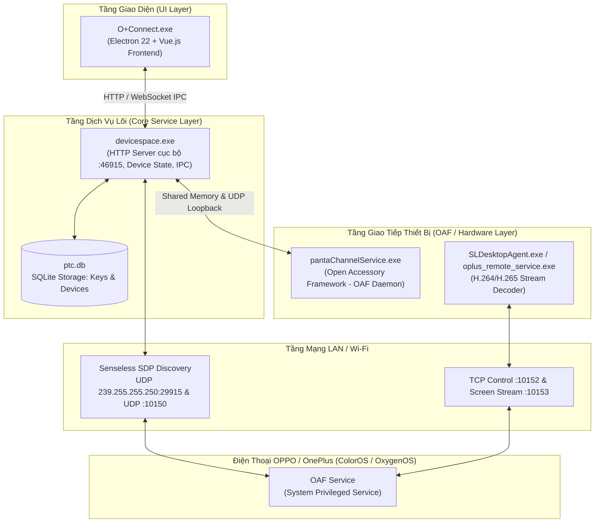

# Tài Liệu Kỹ Thuật Chuyên Sâu & Hướng Dẫn Phát Triển (Technical Architecture & Contributor Guide)

> **Dự án:** O+ Connect for Linux (OPPO & OnePlus PC Connect on Wine/Proton)  
> **Dành cho:** Nhà phát triển (Developers), Kỹ sư dịch ngược (Reverse Engineers), Contributor và AI Coding Agents muốn **Fork**, tùy biến, hoặc đóng góp phát triển dự án.

---

## 📑 Mục Lục

1. [Tổng quan Kiến trúc Hệ thống (System Architecture)](#1-tổng-quan-kiến-trúc-hệ-thống-system-architecture)
2. [Giao thức Mạng & Luồng Dữ liệu (Network Protocols & Traffic)](#2-giao-thức-mạng--luồng-dữ-liệu-network-protocols--traffic)
3. [Kỹ thuật Dịch ngược & Các Bản Vá Nhị Phân (Reverse Engineering & Patches)](#3-kỹ-thuật-dịch-ngược--các-bản-vá-nhị-phân-reverse-engineering--patches)
   - [3.1 Bỏ qua bẫy cài đặt .NET Framework 4](#31-bỏ-qua-bẫy-cài-đặt-net-framework-4)
   - [3.2 Vô hiệu hóa Toast Notification](#32-vô-hiệu-hóa-toast-notification)
   - [3.3 Giải cứu pantaChannelService & Sửa lỗi Mã QR Trắng](#33-giải-cứu-pantachannelservice--sửa-lỗi-mã-qr-trắng)
   - [3.4 Vá Logic Kiểm tra SSID trong app.asar](#34-vá-logic-kiểm-tra-ssid-trong-appasar)
   - [3.5 Tương thích Wayland & HiDPI Scaling](#35-tương-thích-wayland--hidpi-scaling)
4. [Hướng dẫn Môi trường Phát triển & Debug (Developer Workflow)](#4-hướng-dẫn-môi-trường-phát-triển--debug-developer-workflow)
5. [Các Bài Toán Mở Kêu Gọi Cộng Đồng Fork & Giải Quyết (Roadmap for Forks)](#5-các-bài-toán-mở-kêu-gọi-cộng-đồng-fork--giải-quyết-roadmap-for-forks)

---

## 1. Tổng quan Kiến trúc Hệ thống (System Architecture)

Ứng dụng O+ Connect trên Windows được xây dựng theo mô hình kiến trúc phân tầng đa tiến trình (Multi-process Architecture):



### Chi tiết các thành phần:
1. **`O+Connect.exe` (Frontend):** Ứng dụng Electron đóng gói mã nguồn Vue.js trong file `resources/app.asar`. Quản lý cửa sổ, hiển thị mã QR, danh sách thiết bị và khung chiếu màn hình.
2. **`devicespace.exe` (Backend Core):** Daemon C++ chạy nền. Khởi tạo một HTTP REST API cục bộ trên cổng `46915` (với các endpoint `/probe_devices`, `/request_connection`, `/generate_qrcode`). Đây là "bộ não" điều phối toàn bộ vòng đời kết nối.
3. **`pantaChannelService.exe` (OAF Daemon):** Dịch vụ phụ trách giao tiếp phần cứng (Bluetooth BLE, Wi-Fi Direct, Radio states). Nó kết nối với `devicespace.exe` qua UDP loopback và bộ nhớ chia sẻ (Shared Memory EventBus).
4. **`SLDesktopAgent.exe` & `oplus_remote_service.exe`:** Bộ giải mã và hiển thị luồng video màn hình truyền từ điện thoại qua giao thức TCP.
5. **`ptc.db` (SQLite):** Nằm tại `%LOCALAPPDATA%/Oplus/OplusConnect/ptc.db`. Lưu trữ `deviceId`, định danh pairing, và cặp khóa trao đổi bí mật (`ClientKeyChange`/`ServerKeyChange`). Một khi đã ghép đôi thành công, cặp khóa này được lưu vĩnh viễn, cho phép các lần kết nối sau không cần quét lại mã QR.

---

## 2. Giao thức Mạng & Luồng Dữ liệu (Network Protocols & Traffic)

Quá trình giao tiếp giữa máy tính và điện thoại OPPO trải qua 3 giai đoạn:

### Giai đoạn 1: Khám phá thiết bị (Senseless SDP Discovery)
- Máy tính phát liên tục các gói tin **UDP Multicast** tới địa chỉ `239.255.255.250:29915` và **UDP Broadcast** trên cổng `10150`.
- Điện thoại OPPO khi cùng mạng Wi-Fi và có bật tính năng "Kết nối với máy tính" sẽ lắng nghe multicast và phản hồi lại IP của nó.

### Giai đoạn 2: Bắt tay & Xác thực (Handshake & Authentication)
- Khi người dùng quét mã QR hoặc bấm vào thiết bị trong danh sách:
  1. Máy tính mở kết nối **TCP Unicast** tới cổng `10152` của điện thoại.
  2. Hai bên trao đổi khóa bảo mật AES qua giao thức mật mã độc quyền của OPPO.
  3. Sau khi xác thực thành công, trạng thái kết nối chuyển thành `PAIRED` và ghi vào `ptc.db`.

### Giai đoạn 3: Chiếu màn hình & Truyền dữ liệu (Streaming & Data Transfer)
- Điện thoại mở luồng xuất video H.264/H.265 qua cổng **TCP 10153**.
- Máy tính giải mã luồng video trực tiếp với độ trễ cực thấp (< 30ms trên mạng Wi-Fi 5GHz).
- Các lệnh điều khiển chuột/bàn phím từ máy tính được đóng gói gửi ngược lại điện thoại qua socket TCP `10152`.

---

## 3. Kỹ thuật Dịch ngược & Các Bản Vá Nhị Phân (Reverse Engineering & Patches)

Dưới đây là chi tiết phân tích từng bản vá nhị phân được thực thi tự động trong [`patch_oplus.py`](patch_oplus.py):

### 3.1 Bỏ qua bẫy cài đặt .NET Framework 4
- **Hiện tượng:** Chạy trực tiếp `OplusConnectSetup.exe` trên Wine sẽ trả về:
  `Failed to locate an installed .NET Framework 4 runtime. HRESULT: 0x80070490`.
- **Cơ chế bẫy:** File `.exe` thực chất là một Bootstrapper kiểm tra các key Registry Windows `HKEY_LOCAL_MACHINE\SOFTWARE\Microsoft\NET Framework Setup\NDP\v4\Full`.
- **Giải pháp:** Sử dụng công cụ `7z` giải nén trực tiếp PE Resource `103` (thực chất là một file 7-zip archive nhúng trong resource `.rsrc/2052/RCDATA/103` hoặc `.rsrc/1033/RCDATA/103`). Cách này lấy được toàn bộ 100% file gốc mà không cần cài đặt .NET runtime.

---

### 3.2 Vô hiệu hóa Toast Notification
- **Hiện tượng:** Ứng dụng ném lỗi assertion unhandled exception trong `toastNotification.dll` khi giao tiếp với Windows Runtime Toast API.
- **Giải pháp:** Đổi tên `toastNotification.dll` thành `toastNotification.dll.bak`. Ứng dụng sử dụng khối `try/catch` khi gọi thư viện này nên sẽ âm thầm bỏ qua tính năng toast mà không gây crash giao diện.

---

### 3.3 Giải cứu `pantaChannelService` & Sửa lỗi Mã QR Trắng

> [!CRITICAL]
> Đây là bản vá quan trọng nhất quyết định việc O+ Connect có thể chạy được trên Linux hay không!

#### 1. Nguyên nhân sâu xa:
- Khi `devicespace.exe` khởi động, nó kiểm tra cờ `OAF_INIT_FLAG`. Nếu cờ này là `false`, API `/generate_qrcode` trả về lỗi HTTP 500: `OAF SDK isn't initialized`. Kết quả là ô mã QR trên giao diện bị trắng tinh.
- Để cờ này thành `true`, `pantaChannelService.exe` phải chạy và phản hồi thành công qua UDP loopback `46915`.
- Tuy nhiên, trong `pantaChannelService.exe`, hàm khởi tạo phần cứng gọi WinRT `Windows.Devices.Radios.Radio::GetRadiosAsync` thông qua coroutine C++/WinRT.
- Wine chưa cài đặt class này (`REGDB_E_CLASSNOTREG`). Lệnh gọi ném ra ngoại lệ `0x80040154` không được bắt, làm `pantaChannelService.exe` crash ngay lập tức với mã thoát `0xFFFFFFFC` (`-4`).
- `devicespace.exe` thấy service chết liền cố gắng restart liên tục (restart loop), tiêu tốn tài nguyên và khiến OAF SDK không bao giờ khởi tạo xong.

#### 2. Thất bại của giải pháp Dummy Sleep Stub:
- Nếu thay thế `pantaChannelService.exe` bằng một file `.exe` rỗng chỉ có `Sleep(INFINITE)`: Vòng lặp restart dừng lại, nhưng vì không có phản hồi UDP IPC handshake, `OAF_INIT_FLAG` mãi mãi là `false` -> Mã QR vẫn bị trắng.

#### 3. Bản vá Nhị phân Nhắm mục tiêu (Targeted Binary Patch):
Thay vì thay thế toàn bộ, ta giữ nguyên tiến trình gốc nhưng **triệt tiêu các hàm gọi WinRT Radio**:

1. **Vá lỗi thiếu thư viện Minidump:**
   - Trong bảng Import của file PE, chuỗi `api-ms-win-core-debug-minidump-l1-1-0.dll` gây lỗi nạp `0xC0000135`.
   - Ta ghi đè chuỗi này bằng `dbghelp.dll\x00` (kèm padding null byte).
2. **Patch `RadioManager::enumerateRadios`:**
   - **Byte Pattern:** `48 89 5c 24 08 55 56 57 41 54 41 55 41 56 41 57 48 8d 6c 24 d9 48 81 ec a0 00 00 00`
   - **Offset trong v17.100.10:** `0x88010`
   - **Thao tác:** Ghi đè byte đầu tiên thành `0xc3` (`ret`).
3. **Patch `WindowsWiFiDirect::closeCoroutine`:**
   - **Byte Pattern:** `48 89 54 24 10 48 83 ec 38 41 ba 58 00 00 00 4e 89 4c 12 01`
   - **Offset trong v17.100.10:** `0x26ece0`
   - **Thao tác:** Ghi đè byte đầu tiên thành `0xc3` (`ret`).

*Kết quả sau khi patch:* Khi hàm liệt kê Radio được gọi, nó ngay lập tức `ret` mà không gọi vào WinRT coroutine. `pantaChannelService.exe` khởi động thành công, trả lời bắt tay IPC với `devicespace.exe`, `OAF_INIT_FLAG` chuyển thành `true` và mã QR xuất hiện hoàn hảo!

---

### 3.4 Vá Logic Kiểm tra SSID trong `app.asar`
- **Nguyên nhân:** Trong file `resources/app.asar`, hàm lấy tên Wi-Fi:
  ```javascript
  let t = (await s.wifiConnections())[0].ssid;
  ```
  Trên môi trường Wine, lệnh gọi hệ thống của thư viện `systeminformation` trả về danh sách rỗng (`[]`). Lệnh truy cập thuộc tính `.ssid` ném lỗi `TypeError: Cannot read properties of undefined (reading 'ssid')`, khiến ứng dụng tự chuyển sang chế độ Offline (mất mạng).
- **Kỹ thuật vá In-place:**
  Vì đây là file ASAR (Archive nhị phân có index lưu offset cố định), nếu độ dài file bị thay đổi dù chỉ 1 byte thì toàn bộ ASAR archive sẽ bị hỏng header:
  - **Chuỗi gốc (217 bytes):**
    ```javascript
    try{T();let t=(await s.wifiConnections())[0].ssid;0===t.trim().length&&(l.info(E,"ssid get fail, use cmd!"),t=await this.getCurrentWiFiSSID(),console.error("ssid===1: "+t),l.info(E,"ssid is: "+t)),e(t)}catch(e){t(e)}}
    ```
  - **Chuỗi thay thế (đúng 217 bytes với comment padding):**
    ```javascript
    try{let n=await s.wifiConnections();let a=(n&&n[0]&&n[0].ssid)?n[0].ssid:"WLAN";e(a)}catch(n){e("WLAN")}/*AAAAAAAAAAAAAAAAAAAAAAAAAAAAAAAAAAAAAAAAAAAAAAAAAAAAAAAAAAAAAAAAAAAAAAAAAAAAAAAAAAAAAAAAAAAAAAAAAAAAAAAA*/
    ```

---

### 3.5 Tương thích Wayland & HiDPI Scaling
- Khi chạy Electron cũ trên Wine dưới môi trường Wayland, cửa sổ đồ họa hay gặp hiện tượng đen ngòm hoặc đóng băng do driver OpenGL không tương thích.
- Cờ bắt buộc khi khởi chạy:
  - `--disable-gpu`: Chuyển sang phần mềm render phần khung giao diện Electron (không ảnh hưởng đến luồng giải mã video của service stream).
  - `--force-device-scale-factor=2`: Scale giao diện 2x rõ nét trên màn hình 2K/4K.

---

## 4. Hướng Dẫn Môi Trường Phát Triển & Debug (Developer Workflow)

Dành cho bạn khi muốn nghiên cứu sâu hơn hoặc kiểm tra các bản cập nhật mới từ OPPO:

### 4.1 Thư mục Log của ứng dụng
Mọi nhật ký chi tiết đều được ghi lại tại:
```bash
$WINEPREFIX/drive_c/users/$USER/AppData/Local/Oplus/OplusConnect/log/
```
- `core-daemon.log`: Log hoạt động của `devicespace.exe`.
- `render.log`: Log console của giao diện Vue.js Electron.
- `devicespace.log`: Log IPC và kết nối socket.

### 4.2 Theo dõi log thời gian thực
```bash
tail -f "$WINEPREFIX/drive_c/users/$USER/AppData/Local/Oplus/OplusConnect/log/"*.log
```

### 4.3 Trích xuất và Đóng gói lại `app.asar`
Nếu bạn muốn sửa trực tiếp giao diện Vue:
```bash
npm install -g @electron/asar

# Trích xuất
asar extract "$APP_DIR/resources/app.asar" /tmp/asar_extracted

# Chỉnh sửa code trong /tmp/asar_extracted ...

# Đóng gói lại
asar pack /tmp/asar_extracted "$APP_DIR/resources/app.asar"
```

### 4.4 Bật Wine Debug nâng cao
Khi cần điều tra crash DLL mới:
```bash
WINEDEBUG=+relay,+seh,+loaddll wine O+Connect.exe 2>&1 | grep -iE "fail|error|crash"
```

---

## 5. Các Bài Toán Mở Kêu Gọi Cộng Đồng Fork & Giải Quyết (Roadmap for Forks)

Chúng tôi rất mong muốn cộng đồng mã nguồn mở cùng tham gia giải quyết 4 bài toán kỹ thuật còn lại:

### 🧩 Bài toán 1: Tự động cập nhật Gateway IP khi dùng Hotspot (Ưu tiên cao)
- **Vấn đề hiện tại:** Khi máy tính kết nối vào Hotspot phát từ điện thoại, Android drop gói UDP Multicast discovery. Đồng thời giao diện Vue (`render.log`) bị cache IP Wi-Fi cũ (`192.168.1.5`) thay vì IP Gateway Hotspot mới (`192.168.154.218`), dẫn đến lỗi Timeout sau 5s khi bấm kết nối.
- **Hướng giải quyết:** Chỉnh sửa file JavaScript renderer trong `app.asar`, bổ sung cơ chế kiểm tra: nếu không tìm thấy thiết bị qua Senseless SDP, tự động lấy địa chỉ Default Gateway hiện tại của máy tính (`ip route | grep default`) và thử mở socket tới Gateway IP cổng `10152`.

### 🧩 Bài toán 2: Viết Linux Native System Tray & Tự khởi động
- **Mục tiêu:** Tạo một daemon nhỏ bằng **Python (PyQt/Pyside)** hoặc **Rust** chạy ở khay hệ thống Linux (System Tray):
  - Nhận diện khi điện thoại vào mạng để tự động kích hoạt O+ Connect ngầm.
  - Cho phép thu nhỏ cửa sổ xuống khay hệ thống thay vì chiếm thanh tác vụ (Taskbar).

### 🧩 Bài toán 3: Giao thức kết nối có dây USB không cần USB Debugging
- **Mục tiêu:** Nghiên cứu giao thức AOA (Android Open Accessory) hoặc RNDIS USB Tethering của OPPO để khi cắm dây cáp Type-C vào máy tính Linux, app tự động nhận diện và kết nối mà không cần Wi-Fi và **tuyệt đối không cần bật USB Debugging** (để giữ an toàn cho app Ngân hàng & VNeID).

### 🧩 Bài toán 4: Đóng gói Phân phối (Packaging)
- Xây dựng file `PKGBUILD` để đưa lên **Arch User Repository (AUR)** (`yay -S oplus-connect`).
- Xây dựng bundle **Flatpak** độc lập để chạy mượt mà trên SteamOS (Steam Deck), Fedora Silverblue, Ubuntu.

---

## 🤝 Cách Đóng Góp (Contributing)

1. Nhấn nút **Fork** ở góc phải trên cùng của repository này.
2. Tạo nhánh làm việc: `git checkout -b feature/ten-tinh-nang`.
3. Kiểm thử kỹ lưỡng các bản vá trên môi trường của bạn.
4. Gửi **Pull Request (PR)** kèm mô tả chi tiết log kiểm thử.

*Cùng nhau, chúng ta sẽ mang trải nghiệm liền mạch của hệ sinh thái ColorOS / OxygenOS lên thế giới Linux!*
